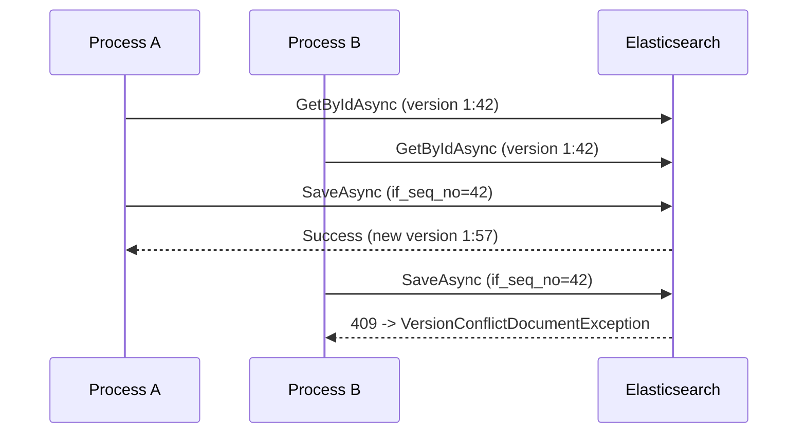

# Versioning

Foundatio.Repositories provides optimistic concurrency control (OCC) for documents that implement `IVersioned`. This guide explains what the version is, which operations check it, how retries work, and the known gaps.

::: info Audit in progress
The behavior described here is the **current** behavior. Several inconsistencies are tracked in [#344](https://github.com/FoundatioFx/Foundatio.Repositories/issues/344). They're called out below as **Known gap**.
:::

## Enabling Versioning

Implement `IVersioned` on your entity:

```csharp
using Foundatio.Repositories.Models;

public class Employee : IIdentity, IHaveDates, IVersioned
{
    public string Id { get; set; } = string.Empty;
    public string Name { get; set; } = string.Empty;
    public DateTime CreatedUtc { get; set; }
    public DateTime UpdatedUtc { get; set; }
    public string Version { get; set; } = string.Empty;  // Required by IVersioned
}
```

## What the Version Is

`Version` is an `ElasticDocumentVersion` serialized as `"primaryTerm:sequenceNumber"`, e.g. `"1:42"`. Both numbers come from Elasticsearch **hit metadata**, not from the document body:

| Field | Meaning |
| --- | --- |
| `_seq_no` | Increases with **every operation on the shard**, not per document. Two consecutive writes to the same document can go from `1:42` to `1:57` if other documents on that shard were written in between. |
| `_primary_term` | Increases each time a new primary takes over the shard (failover). |

Versions are ordered by primary term first, then by sequence number. They're only comparable for the **same document in the same index**. Different shards and different indexes have independent sequences.

Elasticsearch returns these values on GET/mget responses, on write responses, and on search hits **only** when the search asks for them with `seq_no_primary_term=true`. The repository does that automatically for `IVersioned` types.

::: tip `_version` is something else
Elasticsearch also has `_version`, a per-document write counter. Since Elasticsearch 7.0 it can't be used for optimistic concurrency, because it isn't safe across primary failover. The supported mechanism is `if_seq_no` + `if_primary_term` ([Elasticsearch docs](https://www.elastic.co/docs/reference/elasticsearch/rest-apis/optimistic-concurrency-control)). That's what this library uses. External versioning (`version_type=external`) isn't used. It's meant for a system where another store owns the version, it can't be combined with `if_seq_no`, and the Update API doesn't support it.
:::

## Read-Modify-Write Cycle

```csharp
// 1. Read document (Version is populated from hit metadata)
var employee = await repository.GetByIdAsync(id);
Console.WriteLine(employee.Version);  // e.g., "1:42"

// 2. Modify document
employee.Name = "John Smith";

// 3. Save document. Elasticsearch receives if_seq_no=42 & if_primary_term=1.
await repository.SaveAsync(employee);
// Success: employee.Version is updated from the write response (e.g., "1:57")
// Mismatch: VersionConflictDocumentException (HTTP 409)
```



## Where the Version Comes From on Reads

| Read | How `Version` is set |
| --- | --- |
| `GetByIdAsync` / `GetByIdsAsync` | Always overwritten from GET metadata. **Known gap:** when metadata is missing it becomes `"0:0"`. |
| `FindAsync` / `FindOneAsync` / `SearchAsync` | Overwritten from hit metadata **when present**. Otherwise the stored `_source` value is kept. |
| Cache hit | Returns the cached `FindHit`, whose `Version` was taken when it was cached. A cached document can be stale; saving it fails safely with a 409. |
| `FindAsAsync<TResult>`, `top_hits` aggregations | Built from `_source` only. Any `Version` here is the stale stored value. |

`hit.Version` (on `FindHit<T>`) and `hit.Document.Version` normally agree for repository reads.

### The stored `_source.version` is stale

Today `IVersioned.Version` is also serialized into the document body. The value is written **before** Elasticsearch assigns the new sequence number, so the stored value is always the version the write started from, not the version it produced. Script and Partial patches (Update API) never touch it at all.

The repository ignores it on reads (see the table above), but raw Elasticsearch queries, Kibana and other clients see a misleading value. **Do not query, sort or aggregate on `version` in `_source`**, and don't treat it as the document's current version. Removing it from `_source` is tracked in [#344](https://github.com/FoundatioFx/Foundatio.Repositories/issues/344).

### Versions after reindex

Reindexing (schema migrations via `VersionedIndex`, `ReindexAsync`, moving documents between daily or monthly indexes) writes the documents into a new index with fresh sequence numbers. Elasticsearch does **not** preserve `_seq_no`/`_primary_term`. A version captured before the reindex will cause a 409 on the next save. Re-read the document after a reindex.

### Caching and versions

When caching is enabled, cached reads return the `FindHit` (and its `Version`) as it was when cached. If the document has changed since, saving the cached copy fails with `VersionConflictDocumentException`, which is the safe outcome. Re-read with `o.Cache(false)` and retry. The cache population race (stale data cached after invalidation) is tracked separately in [#323](https://github.com/FoundatioFx/Foundatio.Repositories/issues/323).

## Concurrency Model per Operation

| Operation | Mechanism | Uses your `Version`? | Retries |
| --- | --- | --- | --- |
| `AddAsync` | `op_type=create` | No (a duplicate id raises `DuplicateDocumentException`) | Bulk only: 429/503 |
| `SaveAsync` (one document) | index with `if_seq_no`/`if_primary_term` from `Version` | **Yes**, unless `SkipVersionCheck()` | None. **Known gap:** no 429/503 retry |
| `SaveAsync` / `AddAsync` (many documents) | bulk with `if_seq_no` per document | **Yes**, unless `SkipVersionCheck()` | 429/503: up to 4 attempts (1s/2s/4s backoff). 409 is never retried |
| `PatchAsync(id)` ScriptPatch / PartialPatch | Update API with `retry_on_conflict` | No: last write wins | Server-side, `Retry(n)` times (default 10) |
| `PatchAsync(id)` JsonPatch / ActionPatch, or Partial with a default pipeline | GET, apply, index with `if_seq_no` **from that GET** | No: checks against the fresh GET | Resilience policy: `Retry(n)` **attempts**, otherwise the policy default |
| `PatchAsync(id)` ScriptPatch with a default pipeline | update-by-query on the id | No | None. Throws on conflict |
| `PatchAsync(ids)` / `PatchAllAsync` JsonPatch / ActionPatch / pipeline Partial | bulk index with `if_seq_no` from the search hits | No | Conflicting ids are re-run one at a time through `PatchAsync(id)`. **Known gap:** ignores `SkipVersionCheck()` |
| `PatchAllAsync` ScriptPatch / PartialPatch (bulk Update API) | bulk update with `retry_on_conflict` | No | Server-side |
| `PatchAllAsync` ScriptPatch with caching disabled | update-by-query, `conflicts=proceed` | No | **Known gap:** conflicting documents are skipped and only logged |
| `RemoveAsync` | delete | **No** | Bulk only: 429/503 |
| `RemoveAllAsync` (no listeners, no cache) | delete-by-query, `conflicts=proceed` | No | Re-runs up to `Retry(n) + 1` passes while conflicts remain. Leftovers are only logged |

Patches are **last-write-wins by default** for your copy of the document. There's no option today to patch only if the document is still at a version you read. Use a read-modify-`SaveAsync` cycle when you need that.

### Query-based writes check against a snapshot

`PatchAllAsync` (via update-by-query) and `RemoveAllAsync` (via delete-by-query) take a snapshot of matching documents, then write each one with a sequence-number check against **that snapshot**. A concurrent change is never overwritten; the document is counted as a version conflict and skipped. Running two of them in parallel on overlapping documents is safe, but each may skip documents the other changed. Elasticsearch scripts can't read `_seq_no` or `_primary_term`, so a script can't compare against a caller-supplied version.

## Retry Options

`o.Retry(n)` is interpreted differently depending on the path:

- **Update API** (Script/Partial patches): `retry_on_conflict = n`, i.e. n server-side retries. Default **10**.
- **Resilience policy** (JsonPatch, ActionPatch, pipeline Partial): n total **attempts** (n - 1 retries). When `Retry` isn't set, the repository's resilience policy is used as configured; the Foundatio default is 3 attempts with exponential backoff starting at 1 second. The policy doesn't retry `DocumentNotFoundException` or `DuplicateDocumentException`, but it **does** retry `VersionConflictDocumentException`. Each attempt re-fetches the document.
- **Delete-by-query**: up to n + 1 passes (default 11), with no delay between passes.
- **`SaveAsync`/`AddAsync`**: `Retry(n)` has **no effect**.

Normalizing these is tracked in [#344](https://github.com/FoundatioFx/Foundatio.Repositories/issues/344).

## Handling Version Conflicts

```csharp
try
{
    await repository.SaveAsync(employee);
}
catch (VersionConflictDocumentException)
{
    // Someone else changed the document. Re-read and decide what to do.
}
```

### Retry pattern

Re-read **without the cache** on each attempt, so you don't keep retrying with the same stale version:

```csharp
public async Task<Employee> UpdateWithRetryAsync(string id, Action<Employee> update, int maxAttempts = 5)
{
    for (int attempt = 1; ; attempt++)
    {
        var employee = await repository.GetByIdAsync(id, o => o.Cache(false))
            ?? throw new DocumentNotFoundException(id);

        update(employee);

        try
        {
            return await repository.SaveAsync(employee);
        }
        catch (VersionConflictDocumentException) when (attempt < maxAttempts)
        {
            await Task.Delay(TimeSpan.FromMilliseconds(50 * Math.Pow(2, attempt) + Random.Shared.Next(25)));
        }
    }
}
```

### Server-side updates

When you don't need to compare against a version you read (for example a counter), let Elasticsearch apply the change to the latest document:

```csharp
await repository.PatchAsync(id, new ScriptPatch("ctx._source.counter++"));
```

This is last-write-wins at the document level. Elasticsearch re-runs the script on the latest document on conflict (up to `Retry(n)` times). If the retries run out, `VersionConflictDocumentException` is thrown.

## Skipping the Version Check

```csharp
await repository.SaveAsync(employee, o => o.SkipVersionCheck());
```

::: danger Known gap: `VersionCheck(bool)` is inverted
`o.VersionCheck(false)` currently **enables** the check, and `o.VersionCheck(true)` **skips** it. Use `SkipVersionCheck()` until this is fixed ([#344](https://github.com/FoundatioFx/Foundatio.Repositories/issues/344)).
:::

`SkipVersionCheck()` applies to `SaveAsync` and to the single-document JsonPatch, ActionPatch and pipeline Partial patches. The bulk patch paths ignore it today.

Skip the check only when lost updates are acceptable: trusted imports, migrations, or genuine last-write-wins data.

## Bulk Operations and Partial Failures

When saving several versioned documents in one call, some may succeed while others conflict:

1. **Successful documents** are fully processed: versions updated, events fired, cache populated, notifications sent.
2. **Conflicting documents** are left untouched in Elasticsearch and in the cache.
3. A `VersionConflictDocumentException` is thrown after the successes are processed.

```csharp
try
{
    await repository.SaveAsync(employees);
}
catch (VersionConflictDocumentException ex)
{
    // Successful documents were saved and notified. Re-fetch and retry the rest.
    _logger.LogWarning(ex, "Some documents had version conflicts");
}
```

## Indexes Without Sequence Numbers (Elasticsearch 9.4+)

Elasticsearch 9.4 disables sequence numbers by default (`index.disable_sequence_numbers=true`, a final setting) for new **time_series data stream backing indexes**. On those indexes:

- Responses carry the sentinel values `_seq_no: -2, _primary_term: 0`.
- Writes with `if_seq_no` fail with HTTP **400** (`occ_not_supported_exception`), not 409.
- The Update API fails with HTTP 400 (`update_not_supported_exception`).
- Update-by-query and delete-by-query run with no conflict detection.

**`IVersioned` repositories aren't supported on such indexes.** Either don't implement `IVersioned` for time-series data, or set `index.disable_sequence_numbers: false` in the index template. Standard and logsdb indexes keep sequence numbers. They may use `index.seq_no.index_options=doc_values_only` (9.1+), where OCC still works. Better handling for the sentinel values is tracked in [#344](https://github.com/FoundatioFx/Foundatio.Repositories/issues/344).

## Best Practices

1. Handle `VersionConflictDocumentException` wherever you call `SaveAsync` on an `IVersioned` type. Map it to HTTP 409 in APIs.
2. Retry by **re-reading** (bypass the cache) and re-applying the change. Use exponential backoff with jitter and a small attempt budget.
3. Prefer `ScriptPatch` for server-side changes that don't depend on a value you read.
4. Never rely on the `version` stored in `_source`.
5. Treat `Version` as an opaque string. Compare versions with `ElasticDocumentVersion` only for the same document in the same index.

## Next Steps

- [CRUD Operations](/guide/crud-operations) - Save operations with versioning
- [Patch Operations](/guide/patch-operations) - Patch concurrency behavior
- [Caching](/guide/caching) - Cache interaction
- [Troubleshooting](/guide/troubleshooting) - Diagnosing conflicts
